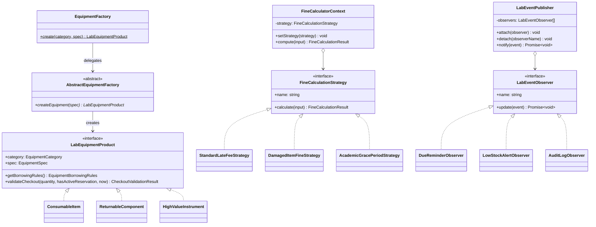
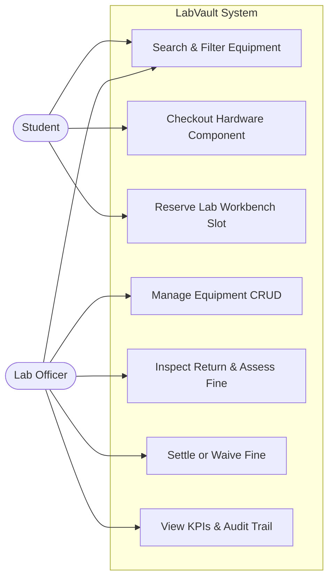

# LabVault — Verified Project Facts (`PROJECT_FACTS.md`)

> **Course:** CSE 3206 Software Engineering Sessional (Lab 6)  
> **Project:** LabVault — Hardware & Lab Component Lending System  
> **Stack:** Next.js 16.4.6 (App Router, TypeScript strict mode), PostgreSQL + Prisma ORM v6.19.0, Tailwind CSS v4 + shadcn/ui (TweakCN Caffeine Theme), Vitest + `@vitest/coverage-v8`, Selenium WebDriver, Swagger/OpenAPI 3.0, GitHub Actions CI.

---

## 1. Exact Folder Structure

```text
.github/
  workflows/
    ci.yml
prisma/
  schema.prisma
  seed.ts
src/
  app/
    api/
      analytics/route.ts
      equipment/route.ts
      equipment/[id]/route.ts
      fines/route.ts
      fines/[id]/settle/route.ts
      loans/route.ts
      loans/[id]/return/route.ts
      openapi/route.ts
      reservations/route.ts
      reservations/[id]/route.ts
    api-docs/page.tsx
    audit/page.tsx
    inventory/page.tsx
    loans/page.tsx
    reservations/page.tsx
    globals.css
    layout.tsx
    page.tsx
  components/
    app-shell.tsx
    ui/ (badge, button, card, dialog, input, label, select, separator, sheet, table, tabs, textarea)
  lib/
    patterns/
      equipment-factory.ts
      fine-strategy.ts
      lab-event-observer.ts
    repositories/
      lab-repository.ts
    services/
      lab-service.ts
      notification-service.ts
      student-verifier.ts
    prisma.ts
    swagger.ts
    types.ts
    utils.ts
tests/
  e2e/
    labvault.selenium.test.ts
  unit/
    equipment-factory.test.ts
    fine-strategy.test.ts
    lab-event-observer.test.ts
    lab-service.test.ts
    services-helpers.test.ts
```

---

## 2. Five Functional Modules & Routes

| # | Module | UI Route | REST API Endpoints |
|---|---|---|---|
| 1 | **Equipment & Kit Inventory** | `/inventory` | `GET /api/equipment`, `POST /api/equipment`, `PATCH /api/equipment/[id]`, `DELETE /api/equipment/[id]` |
| 2 | **Borrow & Return Checkout** | `/loans` | `GET /api/loans`, `POST /api/loans`, `POST /api/loans/[id]/return` |
| 3 | **Damage Inspection & Fine Engine** | `/loans` (return modal) & `/audit` | `POST /api/loans/[id]/return`, `GET /api/fines`, `PATCH /api/fines/[id]/settle` |
| 4 | **Lab Slot Reservation** | `/reservations` | `GET /api/reservations`, `POST /api/reservations`, `PATCH /api/reservations/[id]` |
| 5 | **Usage Analytics & Audit Log** | `/` & `/audit` | `GET /api/analytics` |
| — | **Swagger / OpenAPI 3.0** | `/api-docs` | `GET /api/openapi` |

---

## 3. UML Diagrams (Mermaid)

### 3.1 UML Class Diagram (Design Patterns)



### 3.2 UML Use Case Diagram



---

## 4. Design Patterns Justification

| Pattern | Category | Exact File Path | Problem It Solves | Realistic Alternative Rejected |
|---|---|---|---|---|
| **Factory Method** | Creational | `src/lib/patterns/equipment-factory.ts` | Decouples category-specific borrowing policies (`ConsumableItem` = no return, max 10; `ReturnableComponent` = 7-day loan, max 5; `HighValueInstrument` = 1-day loan, max 1, requires slot reservation) from `LabService.checkoutEquipment`. | A large `switch (equipment.category)` block inside `LabService.checkoutEquipment` — rejected because adding a new category (e.g., `SafetyGear`) would violate the Open/Closed Principle and bloat the checkout method. |
| **Strategy** | Behavioral | `src/lib/patterns/fine-strategy.ts` | Allows `LabService.returnEquipment` to swap fine computation policies (`StandardLateFeeStrategy`, `DamagedItemFineStrategy`, `AcademicGracePeriodStrategy`) at runtime based on return condition and selected lab policy. | Hardcoding nested `if/else` fee formulas inside the `/api/loans/[id]/return` route handler — rejected because policy rules couldn't be unit-tested in isolation or switched dynamically per semester/grace policy. |
| **Observer** | Behavioral | `src/lib/patterns/lab-event-observer.ts` | Decouples core domain actions (checkout, return, stock drop, reservation, fine settlement) from side effects (`DueReminderObserver`, `LowStockAlertObserver`, `AuditLogObserver`). | Calling `notifier.send()` and `repository.createAuditLog()` directly inside every `LabService` method — rejected because it tightly couples business transactions to notification/logging concerns. |

---

## 5. Vitest Unit Tests & Coverage (Verified Run)

- **Command:** `npm run test:coverage` (`vitest run --coverage` with `@vitest/coverage-v8`)
- **Test Count:** **5 test files, 18 tests passed** (0 failed)
  - `tests/unit/equipment-factory.test.ts` (4 tests)
  - `tests/unit/fine-strategy.test.ts` (4 tests)
  - `tests/unit/lab-event-observer.test.ts` (2 tests)
  - `tests/unit/lab-service.test.ts` (6 tests)
  - `tests/unit/services-helpers.test.ts` (2 tests)
- **Mocked Dependencies:** `LabRepository` (all methods mocked via `vi.fn()`), `StudentIdVerifier` (`vi.fn()`), `NotificationDispatcher` (`vi.fn()`), and `AuditLogWriter` (`vi.fn()`) injected via constructor dependency injection into `LabService` and `LabEventPublisher`.
- **Actual Coverage Percentages (`src/lib/patterns/**/*.ts`, `src/lib/services/**/*.ts`):**
  - **All files:** `88.66%` Stmts | `68.34%` Branch | `90.76%` Funcs | `88.38%` Lines
  - **`patterns/`:** `95.9%` Stmts | `86.36%` Branch | `100%` Funcs | `95.79%` Lines
    - `equipment-factory.ts`: `90.69%` Stmts | `100%` Funcs
    - `fine-strategy.ts`: `97.91%` Stmts | `100%` Funcs
    - `lab-event-observer.ts`: `100%` Stmts | `100%` Funcs
  - **`services/`:** `81.6%` Stmts | `52.05%` Branch | `79.31%` Funcs | `81.14%` Lines
    - `lab-service.ts`: `80.53%` Stmts | `80%` Lines
    - `notification-service.ts`: `80%` Stmts | `100%` Funcs
    - `student-verifier.ts`: `100%` Stmts | `100%` Funcs

---

## 6. Selenium WebDriver E2E Scenarios (Verified Run)

- **File:** `tests/e2e/labvault.selenium.test.ts`
- **Command:** `npm run test:e2e` against production `next start -p 3000` (headless Chrome `158.0.8127.88`)
- **Verified Passing Scenarios (4/4):**
  1. **Dashboard KPIs Load:** Navigates to `/`, verifies `Lab Operations Overview` heading and KPI cards render.
  2. **Equipment Inventory Search:** Navigates to `/inventory`, types `"STM32"` into `[data-testid='inventory-search']`, verifies `MCU-STM32-F446` row appears.
  3. **Borrow Checkout Flow:** Navigates to `/loans`, opens checkout modal, submits checkout, verifies `[data-testid='loan-status-banner']` confirms `"Checked out"`.
  4. **Return & Fine Assessment Flow:** Clicks `Return` on an active loan, confirms inspection modal, verifies `[data-testid='loan-status-banner']` updates with `"Returned"`.

---

## 7. Swagger / OpenAPI 3.0 vs. Manual Postman Collections

- **Setup:** `swagger-jsdoc` (`src/lib/swagger.ts`) parses `@openapi` JSDoc blocks in `src/app/api/**/*.ts` and serves the live OpenAPI 3.0.3 JSON specification at `GET /api/openapi`. `swagger-ui-react` renders the interactive explorer at `/api-docs`.
- **Comparison vs. Manual Postman Collections:**
  1. **Single Source of Truth:** `@openapi` annotations live directly above each Next.js Route Handler (`route.ts`), so API documentation evolves with the code in Git PRs rather than drifting out of sync in an exported `.postman_collection.json`.
  2. **Zero-Setup Interactive Testing:** Any TA, reviewer, or frontend developer can visit `/api-docs` and execute `Try it out` requests immediately without importing environment variables or collections into Postman.
  3. **Standards-Based Codegen:** `/api/openapi` outputs standard OpenAPI 3.0.3 JSON, which can be imported into Postman, Insomnia, or TypeScript client generators automatically.

---

## 8. Git Workflow Checklist (For Lab 6 Report)

1. **Branch Naming Convention:**
   - Features: `feat/equipment-factory`, `feat/fine-strategy-engine`, `feat/lab-slot-reservations`, `feat/swagger-openapi-docs`
   - Fixes: `fix/turbopack-build-webpack`, `fix/selenium-dialog-backdrop`
2. **PR #1 (Accepted Cleanly):**
   - Branch: `feat/fine-strategy-engine` → `main`
   - Scope: `src/lib/patterns/fine-strategy.ts` + `tests/unit/fine-strategy.test.ts`
   - Checks: `LabVault CI` passes (`tsc`, `eslint`, `vitest --coverage`, `next build --webpack`). Merged via Squash & Merge.
3. **PR #2 (Requiring Revision Before Merge):**
   - Branch: `feat/lab-slot-reservations` → `main`
   - Review Feedback: Initial commit allowed overlapping reservations on the same workbench if `equipmentId` differed; reviewer requested `findOverlappingReservation(workbench, startTime, endTime)` check and HTTP `409 Conflict` response.
   - Resolution: Pushed fix commit adding overlap check + unit test in `lab-service.test.ts`, CI re-ran and passed, then merged.
4. **Realistic Merge Conflict Scenario to Reproduce & Document:**
   - **Setup:** Create two branches from `main`:
     - `feat/grace-period-policy` edits `resolveFineStrategy` in `src/lib/patterns/fine-strategy.ts` to add a 2-day grace period.
     - `feat/weekend-late-fee` edits the same `resolveFineStrategy` function in `src/lib/patterns/fine-strategy.ts` to discount weekend late days.
   - **Reproduce:** Merge `feat/grace-period-policy` into `main` first, then run `git checkout feat/weekend-late-fee && git merge main`.
   - **Resolve:** Inspect `<<<<<<< HEAD` / `=======` / `>>>>>>> main` markers in `src/lib/patterns/fine-strategy.ts`, combine both policies cleanly, run `npm run test:coverage`, `git add src/lib/patterns/fine-strategy.ts`, and `git commit` to complete the merge.
